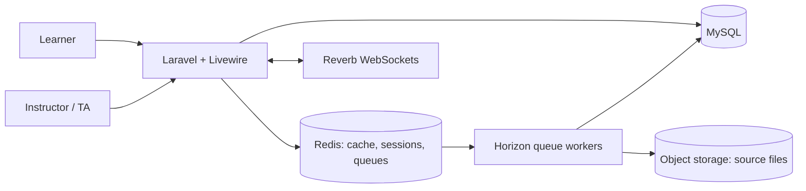

# StudyLoop

**Instructor-approved practice with spaced repetition.** StudyLoop turns an instructor's own course material into practice items that the instructor reviews and approves, then schedules reviews for each learner with a deterministic spaced-repetition algorithm.

> **Status:** early development, following a 6-week roadmap (see below). The Laravel skeleton, local Docker stack, health check and the first piece of the scheduler package are in place; product features are not built yet. The project uses only synthetic course material and is intended for adult learners (18+).

## The problem

Learners forget most course material within weeks, and writing good practice questions takes instructors hours. Generic quiz generators invent facts or test things the course never covered. StudyLoop ties every practice item to an exact passage in the instructor's material, and nothing reaches learners until the instructor approves it.

## Who it's for

- **Instructors:** upload material, review suggested items and publish decks
- **Teaching assistants:** resolve learner disputes and review flagged items
- **Learners:** short daily review sessions
- **Org admins:** manage cohorts and seats

## Demo workflow

1. An instructor uploads synthetic notes, "Intro to HTTP caching", and selects three sections
2. StudyLoop proposes 12 items (multiple choice, cloze, short answer), each beside its highlighted source
3. The instructor rejects 2, edits 1 and publishes 10 as a deck
4. A learner completes a first session and misses the `no-store` question
5. The explanation quotes the source passage; the item is due again tomorrow while correct items move out 6 days
6. The learner disputes another item and a TA resolves it
7. The instructor dashboard flags one item with low discrimination

## Planned features

- Orgs, cohorts, invitations and policy-based authorization
- Material upload (Markdown, text, PDF) with section splitting and versions
- Item bank with draft / in review / published / retired states
- Suggested items anchored to source passages, with accept / edit / reject and reason codes
- Immutable published deck versions
- Daily review sessions with deterministic grading
- SM-2 scheduler (FSRS behind the same interface as a stretch goal)
- "Why was I wrong?" explanations using only the linked passage
- Learner disputes routed to a TA
- Item analytics with small-group suppression
- Live updates for instructors over WebSockets

## Tech stack

| Layer | Technology |
|---|---|
| Application | PHP, Laravel |
| UI | Livewire, Alpine.js, Tailwind CSS |
| Database | MySQL |
| Cache and queues | Redis, Laravel Horizon |
| Realtime | Laravel Reverb |
| Tests and quality | Pest, Larastan, Pint |
| Local environment | Docker Compose |
| CI | GitHub Actions |

## Architecture

One Laravel application organized as a modular monolith by domain. Livewire components call Action classes, and every model has a Policy. The scheduler lives in a framework-free PHP package so its math is easy to test. Suggestion and explanation jobs run on queues, never during a learner's review request; learner sessions work fully without WebSockets.



### Planned repository layout

```text
studyloop/
├── app/Domain/            # Orgs, Materials, Items, Decks, Reviews, Disputes, Analytics
├── app/Livewire/          # Instructor, Learner and Admin components
├── app/Jobs/              # parsing, item suggestions, explanations, rollups
├── database/              # migrations, factories, seeders
├── packages/scheduler/    # pure PHP SM-2 / FSRS with golden tests
├── tests/                 # Pest unit, feature and browser tests
├── infra/                 # Docker, monitoring
└── docs/                  # architecture decisions, runbooks, learning-science notes
```

## Design rules

- Learners never see unapproved items.
- Every published item links to a valid, hash-verified source span.
- Scheduler output matches golden fixtures exactly, with a timezone-aware day boundary.
- A learner in one cohort never sees another cohort's content.
- No grading for credit, no automatic scheduling or publishing by the suggestion step.

## Roadmap

| Week | Focus | Status |
|---|---|---|
| Week 1 | **Laravel bootstrap, orgs & cohorts** — Add product charter, ADR 0001 and Laravel app with Docker services, add scheduler package, setup guide and CI workflow, add organizations, cohorts, role policies and invitations, add org switcher and role-aware navigation with access tests | Planned |
| Week 2 | **Course material, item bank & decks** — Add versioned materials with parsing and source sections, add items with source spans and immutable deck versions, add item editor and deck builder | Planned |
| Week 3 | **Review sessions & SM-2 scheduler** — Implement SM-2 with golden fixtures, add idempotent review submission and learner session, add deterministic grading and document scheduling math | Planned |
| Week 4 | **Suggested items & live review** — Add item draft agent with span validation and review workbench, add provider config, token budgets and usage records, add live draft updates and co-reviewer presence | Planned |
| Week 5 | **Staging, explanations & disputes** — Split Horizon queues, add structured logging and job status, provision staging and add deploy runbook, add quoted explanations with a why panel, add dispute flow and TA queue | Planned |
| Week 6 | **Analytics, hardening & release** — Add item difficulty, discrimination and FSRS behind a flag, cover reconciliation, suppression and due-queue load, add rate limits, CSP and dependency scanning, rehearse restore and tag release candidate, deploy public demo with monitoring | Planned |

## Getting started

Requirements: Docker with Compose v2. PHP, Composer and Node.js run inside containers.

```bash
scripts/setup.sh
```

This creates `.env`, installs dependencies, starts the app, Horizon, MySQL, Redis and Mailpit, runs migrations and builds assets, then checks `GET /health`. The app is served on http://localhost and Mailpit on http://localhost:8025.

Quality checks (also run in CI): `composer lint` (Pint), `composer analyse` (Larastan) and `composer test` (Pest). See [docs/setup.md](docs/setup.md) for environment variables, everyday commands and troubleshooting. Demo accounts will be added together with sign-in and cohorts.
